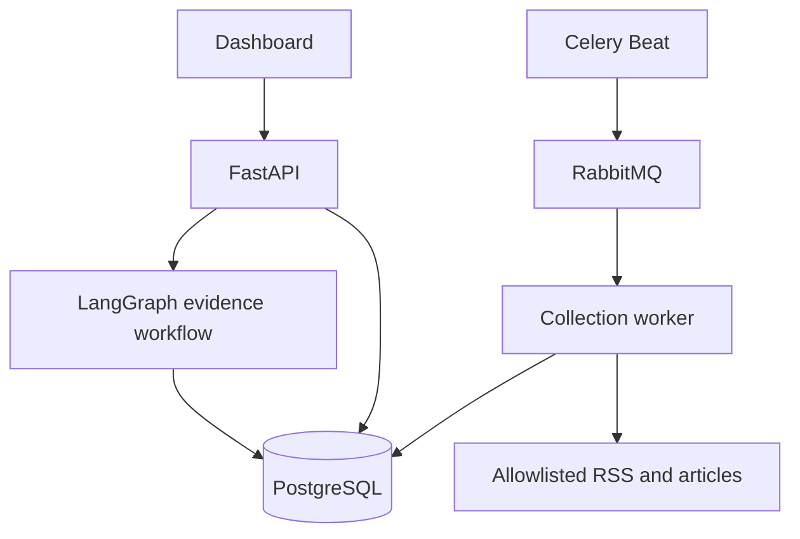

# MarketLens

Evidence-led market research and portfolio monitoring. Built for Vishak's full-stack interview project.

## What works in this release

- Responsive dashboard: overview, portfolio, news intelligence, screening, research history and connections.
- Browser-local sample mode with clearly labelled synthetic prices, news and chart series.
- FastAPI backend with bearer-token authentication and explicit CORS origins.
- CSV holdings import, valuation, concentration flags, missing/stale quote warnings.
- Configured RSS collection, company matching and headline deduplication.
- Optional robots-aware reading of article paragraphs from allowlisted sources.
- LangGraph evidence workflow with citations, timestamps, missing-data checks and an input fingerprint.
- Separate research horizons; a deterministic daily-close trend screen for short-term research.
- Durable PostgreSQL records, RabbitMQ workers and Celery Beat scheduling.
- Research snapshots and JSON exports. No trade execution.

## Honest boundaries

This is a single-owner MVP, not a production investment advisory service. The hosted Site is a static demonstration and API client. Python, PostgreSQL and RabbitMQ must run on a separate Python-capable server. Sample-mode scans never claim to fetch live news.

The frontend is buildless HTML/CSS/JavaScript in this release; Next.js/React migration is not implemented. The LangGraph workflow is real but deterministic: no LLM is connected. Price-provider credentials, broker OAuth, fundamentals, account login, multi-tenant access, notifications, backtesting and exchange-holiday calendars are not implemented. Long-term ranking intentionally returns insufficient evidence until fundamentals and valuation are connected. News sentiment is not treated as a return predictor.

The environment used to build this release blocked DNS access to the configured external news source. Live collection was therefore verified with mocked responses and explicit error reporting, not successful production news retrieval. Browser visual QA was unavailable; DOM interactions and backend workflows were tested.

## Quick start (Python 3.12 recommended)

```bash
python3 -m venv .venv
source .venv/bin/activate
pip install -r requirements.txt
cp .env.example .env
# Edit .env with random secrets. For the single-process quick start:
set -a
source .env
set +a
python -m uvicorn backend.main:app --host 127.0.0.1 --port 8000
```

Open http://localhost:8000. The dashboard starts in sample mode. Open Connections, set the backend URL to http://localhost:8000, and enter API_TOKEN. Swagger API documentation: http://localhost:8000/docs. Sample holdings are not silently uploaded when connecting.

The single-process quick start uses SQLite and manual scans. For PostgreSQL and unattended checks:

```bash
# Fill .env first; docker compose reads it.
docker compose up --build -d
```

Celery Beat enqueues a news scan every weekday on the hour from 03:00–12:00 UTC (08:30–17:30 IST). One beat replica only. The schedule does not exclude market holidays. Workers must remain running for unattended collection. No ChatGPT scheduled task was created.

## Configure news access

`NEWS_FEEDS` is a comma-separated list of permitted RSS feeds. `NEWS_ALLOWED_HOSTS` must explicitly include each feed and article hostname, including www variants. The bundled feed is a configuration example and must be validated with the publisher in your deployment. Source terms and your subscription determine permitted use.

Set `READ_ARTICLES=true` to attempt paragraph extraction after checking robots.txt. Failed robots requests, blocked articles, redirects and paywalls do not get bypassed. Article fetches are capped at 2 MB and time out. Source text is untrusted data; there is no tool-executing LLM or browser session. The reader performs HTTP fetching, not a JavaScript-rendering headless browser.

The MVP uses conservative allowlisting, rejects local/private DNS addresses and never follows redirects. For an internet-facing deployment, use a network egress proxy/firewall as an additional SSRF boundary. Do not expose the source configuration as an unauthenticated API.

## Import data

Holdings template:

```csv
symbol,quantity,average_cost
TCS,10,3800
HDFCBANK,20,1550
```

Supported universe: TCS, INFY, HDFCBANK, ICICIBANK, RELIANCE, SUNPHARMA, LT, ITC. One consolidated lot per symbol; invalid, duplicate, non-finite and non-positive inputs are rejected. CSV import replaces the entire saved portfolio after complete validation.

Use the dashboard import or POST `/api/portfolio/import`:

```json
{"content":"symbol,quantity,average_cost\nTCS,10,3800\n"}
```

Provide licensed daily close prices, ordered oldest to newest, to POST `/api/prices/import`:

```json
{"symbol":"TCS","prices":[100,101,102],"as_of":"2026-10-15T10:00:00Z","source":"Your verified data-provider reference"}
```

These numbers are an input-shape example, not real TCS prices. At least 51 closes are required for trend metrics. The caller is responsible for correct symbol/exchange/currency mapping, chronological order and corporate-action adjustment; the input format currently contains one timestamp for the series endpoint, not per-candle provenance. Quotes older than 96 hours are flagged and cannot support a current trend ranking. Missing prices are excluded from priced P&L instead of being treated as zero-value losses. News without a publication time cannot establish fresh evidence.

All protected API calls require `Authorization: Bearer <API_TOKEN>`.

| Endpoint | Purpose |
|---|---|
| GET /api/health | Backend availability; no secrets |
| GET /api/state | Stored data and report history |
| POST /api/scan | Collect configured sources; errors are returned explicitly |
| POST /api/portfolio/import | Validate and replace holdings |
| GET /api/portfolio | Valuation and concentration |
| POST /api/prices/import | Import a timestamped close-price series |
| POST /api/research | `{ "symbol": "TCS", "horizon": "short" }` or `long` |
| GET /api/export | Report snapshots and current portfolio |

## Research method

Trend score v1 = 50 base + 20 if latest close exceeds 20-day SMA + 20 if 20-day SMA exceeds 50-day SMA + 10 if 20-day momentum is positive. It is a heuristic score, not a probability or validated investment strategy. No volume, liquidity or market regime model is implemented. A research-candidate label needs a score of at least 80, a recent price timestamp, and matching news published within seven days. It is never a buy instruction. Long-term research has no quantitative ranking in this release.

LangGraph: gather matching evidence → calculate/assess → verify and fingerprint inputs. Saved report evidence is a snapshot, not a live pointer into mutable feed state. The fingerprint supports comparison; exact numerical replay also requires retaining the imported price series externally (not yet a versioned warehouse).

## Architecture



Application modules share a database in this MVP. This is not a claim of independently deployed microservices. Worker/API separation is the initial deployment boundary.

## Verification

```bash
python -m pytest -q
node --check dist/app.js
```

Tests cover authentication, portfolio validation, P&L, company matching, insufficient evidence, future timestamps, failed collection, SSRF URL rejection and static serving. DOM checks additionally exercised navigation, news filters, dialogs, watchlist persistence and CSV validation.

## Before public or paid use

Add individual authentication, tenant isolation, role-aware data access, request limits, migration tooling, monitored scheduling, source retention rules, licensed feeds and tested provider adapters. Use HTTPS and keep API_TOKEN server-side where practical. The current shared API token identifies one owner, not multiple users. Browser session storage has normal XSS exposure; do not reuse a production broker credential as this token.

Assess the actual service under applicable research-analyst/investment-adviser requirements before selling recommendations. An educational label does not determine regulatory status. Validate strategies with time-based tests, corporate actions, transaction costs, survivorship and look-ahead bias controls before making performance claims.

## Next milestones

1. Licensed price/fundamental provider and broker read-only OAuth.
2. Real filing ingestion and better entity/event matching with event timestamps.
3. Optional source-grounded LLM explanations with adversarial-content evaluation.
4. Versioned datasets, walk-forward strategy evaluation and paper portfolios.
5. User accounts, tenant isolation, alert delivery and React/Next.js frontend.

## Free Render deployment

`render.yaml` defines one free native Python web service. It serves both the dashboard and FastAPI. It does not provision paid workers, paid databases, RabbitMQ or Redis. The Celery/RabbitMQ Docker deployment remains available separately.

1. Upload this source to a new GitHub repository, preserving `.github/workflows`.
2. Connect the repository to Render using its Blueprint flow and the Free plan.
3. Supply `DATABASE_URL` for a **new project-specific** external PostgreSQL database. Use the SQLAlchemy psycopg URL scheme `postgresql+psycopg://...`; retain provider-required TLS parameters. Do not reuse an employer's application database. No database is created by the Blueprint.
4. Render generates an API_TOKEN. Copy it through the host's secret management into the repository secret MARKETLENS_API_TOKEN; do not commit it. Add MARKETLENS_API_URL with your actual deployed HTTPS URL.
5. Open the deployed dashboard, go to Connections, and set the same origin plus API_TOKEN. If using the existing Sites dashboard instead, its origin is already listed in CORS_ORIGINS. The API also allows its own dashboard's origin through same-origin requests.
6. The GitHub workflow runs four meaningful source collections per weekday and can be run manually. It does not continuously ping a sleeping server. Check your Actions usage allowance and enable repository Actions. Schedules can be delayed, require a default-branch workflow and can be disabled after inactivity in public repositories.

The service sleeps when idle and restarts with an empty local filesystem. Use external PostgreSQL for persistence; local SQLite is not suitable on Render Free. Free Render PostgreSQL currently expires after 30 days, so it is not selected automatically. Render Free is suitable for a demo, not an always-on trading system. No paid resources are authorized by this configuration. Data-provider/API charges are separate from hosting.
